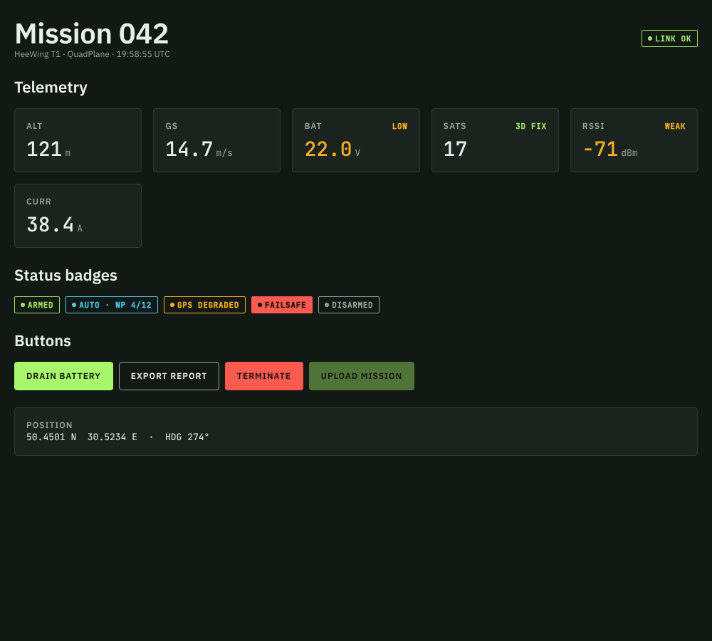

# Ground Control UI

Dark-first design system for ground stations, telemetry dashboards and field reports. Tokens, self-hosted fonts and framework-free Web Components that work in a PWA, on an ESP32 web server, or inside Home Assistant.



## What's inside

```
tokens/tokens.json        ← single source of truth (edit this)
src/components/*.js       ← web components (vanilla, Shadow DOM)
src/css/base.css          ← page base + helpers (.gc-root, .gc-panel, .gc-grid)
fonts/*.woff2             ← IBM Plex Sans + JetBrains Mono, latin + cyrillic, OFL
scripts/build.mjs         ← zero-dependency build
dist/                     ← built output, committed so consumers need no build step
demo/index.html           ← live demo with fake telemetry
ROADMAP.md                ← where this is going
```

`dist/` contains:

| File | Use |
|---|---|
| `ground-control.css` | everything: fonts + tokens + base. One `<link>` and you're done |
| `ground-control.js` | all components, plain script, no dependencies |
| `tokens.css` | only CSS variables + `.gc-<style>` text classes |
| `fonts.css` + `fonts/` | only the `@font-face` rules and files |

## Quick start

```html
<html data-theme="dark">
<link rel="stylesheet" href="ground-control/dist/ground-control.css">
<script src="ground-control/dist/ground-control.js" defer></script>

<body class="gc-root">
  <gc-telemetry-tile label="BAT" value="23.8" unit="V" state="ok" status="OK"></gc-telemetry-tile>
  <gc-status-badge state="critical">FAILSAFE</gc-status-badge>
  <gc-button>Arm</gc-button>
</body>
```

Live updates: `document.querySelector('gc-telemetry-tile').value = 23.7`.

## Adding it to a project

**Git submodule** (recommended: pinned version, easy to update):

```bash
git submodule add git@github.com:irreligious86/ground-control-ui.git vendor/ground-control-ui
cd vendor/ground-control-ui && git checkout v0.1.0
```

**npm from git** (for projects with a bundler):

```bash
npm i github:irreligious86/ground-control-ui#v0.1.0
```

**Copy `dist/`** — for ESP32 (LittleFS / PROGMEM) and Home Assistant `www/`.

### ESP32 notes

Flash is tight, so pick what you need:

- Tokens + components only: `tokens.css` + `ground-control.js` ≈ 8 KB, fonts fall back to `system-ui` / `ui-monospace`.
- Latin-only fonts add ~80 KB, all eight files ~130 KB. Serve them gzip-compressed with long cache headers.

### Offline PWA notes

Add `dist/fonts/*.woff2`, `ground-control.css` and `ground-control.js` to the service worker precache list. Nothing loads from the network.

## Components

| Element | Attributes | Notes |
|---|---|---|
| `<gc-telemetry-tile>` | `label`, `value`, `unit`, `state` (`ok`/`caution`/`critical`), `status` | `.value` property for live updates; mono tabular digits, so numbers don't jump |
| `<gc-status-badge>` | `state` (`ok`/`info`/`caution`/`critical`/`idle`) | text content is required: colour never carries state alone |
| `<gc-button>` | `variant` (`primary`/`secondary`/`danger`), `disabled` | not form-associated yet: call `form.requestSubmit()` yourself |

Style internals from outside via `::part()`, e.g. `gc-telemetry-tile::part(value) { font-size: 40px; }`.

## Tokens

| Token | Meaning |
|---|---|
| `--surface-000/100/200` | map & video / page / panels |
| `--line` | hairlines, decoration only |
| `--ink`, `--ink-muted` | primary / secondary text |
| `--accent-hud` | primary action, focus, nominal |
| `--signal-cyan` | info, navigation, waypoints |
| `--signal-amber` | caution |
| `--signal-red` | critical, failsafe, destructive |
| `--space-1/2/4/6` | 4 / 8 / 16 / 24 px |
| `--radius-sm/md/lg` | 2 / 4 / 8 px |
| `--font-sans`, `--font-mono` | IBM Plex Sans / JetBrains Mono |

Text classes: `.gc-display`, `.gc-title`, `.gc-body`, `.gc-label`, `.gc-caption`, `.gc-readout`, `.gc-data`.

All text tokens pass WCAG 4.5:1 on every surface.

## Development

```bash
node scripts/build.mjs            # rebuild dist/
npm run demo                      # build + serve, open http://localhost:8080/demo/
```

Workflow: edit `tokens/tokens.json` or `src/`, run the build, commit `dist/` together with the source, then tag a release (`git tag v0.2.0`).

The visual reference and brand book live in the Ground Control design system artifact. `tokens/tokens.json` here is the same file — keep them in sync.

## License

Code: private, all rights reserved. Fonts: SIL Open Font License 1.1 (see `fonts/OFL-*.txt`).
